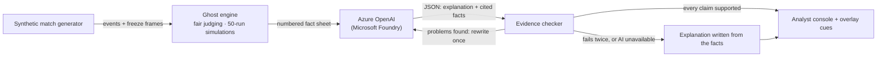

# Ghost Replay: football decisions, reimagined

**Football analytics tells us what happened. Ghost Replay reveals what could have happened.**

Ghost Replay turns a live stream of synthetic football events into an interactive AI analyst for fans, pundits and broadcasters. When a player faces a pivotal decision, it freezes the action, evaluates the plausible alternatives, and simulates how the next few seconds might unfold as defenders react.

Its defining idea is **fair, evidence-backed decision analysis**. A modeled view of what the player could see, player movement, execution difficulty, match context and simulated outcomes separate a *clear missed opportunity* from a *reasonable choice*, or from a moment where there is *not enough evidence to judge*. An **evidence-checked AI** (Azure OpenAI through Microsoft Foundry) explains why each moment mattered, and every claim it makes is checked against the engine's facts before anyone sees it.

What-if timelines, moments of genius, a "You're the player" mode, player analysis and timed broadcast overlay cues turn that intelligence into an experience fans can play with and broadcasters can use.

Built for **Inside the Game: Developer Hackathon** (Microsoft × Premier League), challenge: *The Synthetic Match Insights Engine for Premier League Studio*. **All clubs, players and matches are synthetic; no real Premier League data or video is used.**

---

## The two-minute story

1. **A missed opportunity.** At 0:27 the match freezes: Dunmore shoots (blocked) while a pass to Moreau was on. The vision cone shows Moreau was at the edge of Dunmore's modeled view, so the **Fair Play lens** calls it a *Reasonable alternative*, not a blunder.
2. **What could have happened.** **Watch both** plays the real next seconds and the ghost run side by side, with defenders reacting and live xT and xG for each version. It's labelled *plausible simulation, not a prediction*.
3. **The evidence.** **Why we think this** shows every claim in the AI's explanation with the engine facts it rests on (for example "Nearest defender to Moreau: Yildiran, 0.3 m away").
4. **The AI being checked.** **Try to fool the checker** feeds the validator four false claims ("Moreau was completely unmarked", an invented 97% chance, a player who wasn't there, an offside that didn't happen). It rejects each one and says why.
5. **For the broadcaster.** The full-time report, plus timed overlay cues as JSON that a graphics system could sync to its feed.

Open `http://localhost:5173/?seed=7&speed=8&autostart&jump` to start at step 1 (setup is under [Run it](#run-it)).

---

## How it works

Ghost Replay runs on a **live synthetic event stream**: a seeded match generator plays a whole match and streams its events to the browser in real time (1× to 60× speed). It doesn't ingest real broadcasts or video, and it doesn't need to; the brief is about event data.

| Stage | What happens |
| --- | --- |
| **1. Ingest** | Realistic synthetic matches (formations, pressing, possession spells; about 2.7 goals, 18 shots and 80% passing per match). Every event carries a freeze-frame of all 22 players with their positions and velocities. |
| **2. Interpret** | Live stats: expected goals (xG), expected threat (xT), pass distance, accuracy and difficulty (1–10), ball and shot speed, possession, pressing, momentum, and a rolling five-minute **match pulse**. |
| **3. Explain** | The **ghost engine** judges every decision on the ball (about 1,500 per match), checks the biggest ones in a 50-run simulation, and has the AI explain them, with every claim checked against the facts. |
| **4. Render** | A 3D pitch with four cameras, ghost arrows, the modeled vision cone, outcome trees and the what-if timeline, plus **timed overlay cues as JSON** for broadcast graphics. |
| **5. Personalize** | Follow one player, play **"You're the player"**, draw your own option as a pundit, and read a full-time report with ratings and Decision DNA. |

### Where Microsoft AI fits

The deterministic TypeScript engine is the **authority for every number**: probabilities, distances, xG, xT and simulation results. The language model (**Azure OpenAI through Microsoft Foundry**) does what it's good at, turning those facts into clear analysis, inside an **explain–verify loop**:



1. The engine flags a moment and builds a **numbered fact sheet**: who chose what, the chances, the simulation result, the modeled visibility, and exact distances from the freeze frame.
2. The model must answer in **JSON**, listing each claim with the fact ids it relies on.
3. The **evidence checker** validates the answer: numbers must match the facts, players named must be in the moment, and known contradictions are caught.
4. A rejected answer is sent back **once** with its problems listed. If it fails again, or the model is slow or offline, the viewer gets an explanation written directly from the facts, so the live show never stalls.

The model also writes studio lines, half- and full-time summaries, match-pulse lines, pundit-sketch verdicts and player one-liners, and each is number-checked against its facts.

**Status**

| Microsoft / GitHub piece | Status |
| --- | --- |
| Azure OpenAI via Microsoft Foundry | Integrated in code (`server/src/ai/askAI.ts`); deployment credentials are being added. Without them the app runs fully on fact-built explanations. |
| Azure hosting (Static Web Apps for the client, App Service for the WebSocket server) | Planned |
| GitHub | Git repository, to be published publicly on GitHub for judging; TypeScript monorepo with 69 automated engine tests and a reproducible validation script |

---

## Every feature

### Watching the match live
- **3D pitch** with four cameras: **Broadcast** (TV gantry), **Tactical** (top-down), **Sideline** (always the full width of the pitch) and **Player** (behind the ball).
- **Live stats**: possession, xG, shots, threat added, pass accuracy, average pass difficulty, pressing, ball wins and fouls.
- **Match pulse**: the last five minutes for each side (pressing, territory, threat and predictability) and the spell the game is in, such as *"Control without penetration"* or *"Sustained pressure, but passing is becoming predictable"*, with a checked AI line when a new spell starts.
- **Real-time player tags** pop up when a player **sprints** ("Brzezina · 27 km/h") or leads the match for **distance covered** ("Moreau · 9.0 km covered").
- **Pitch footer** for every action: type, who passed to whom, distance, pass difficulty (1–10), ball speed and threat added.
- **Live commentary** in a broadcast-style lower third, a goal banner, and **studio analysis** at 15, 30, 60 and 75 minutes plus half and full time.
- **Match scrubber** (0' to 90') with clickable markers for ghost moments, moments of genius and goals, plus a **timeline / live insights** feed.
- **Playback**: pause, 1× to 60× speed, and **Next moment** to jump to the next big decision.

### Ghost moments (a better option was on)
- **The freeze**: the camera swoops over the moment and three arrows appear: what they **chose** (coral), the **better option** (blue) and other alternatives (dashed grey). Drag to rotate, pan and zoom, with **Reset view**.
- **Fair Play lens**: one plain verdict per miss: **Clear opportunity missed**, **Reasonable alternative** (with the reason, such as "it was at the edge of their modeled view"), or **Not enough evidence to judge**.
- **Confidence** (high, medium or low): how sure the engine is that the other option really was better. Low-confidence moments never freeze the match.
- **Why it mattered**: an AI explanation that names the cause ("Yildiran stepped out to press, which left space behind them for Rasmark"), with **Why we think this** and **Try to fool the checker** underneath.
- **Chosen vs better option**: chance it comes off, xG per attempt, how often it leads to a shot, how often the ball is lost, whether it was in the player's modeled view, what it sets up next, and how hard it was to execute.
- **Key factors** in plain English: space around the receiver, which defender left the gap, who was already running, overloads, a high back line, line-breaking passes, the receiver's finishing record and the game state ("protecting a 1-0 lead, 87'").
- **All options**: every option the player had, with its modeled visibility, chance, expected value and simulated xG; any option can be simulated.

### Fair judging (the usual criticisms, answered)
| The usual criticism | What Ghost Replay does |
| --- | --- |
| "You're blaming players for things they couldn't see." | A **modeled field of view** from the player's movement and the last pass labels each option *in view*, *edge of view*, *outside view* or *unknown*. Options outside the modeled view are **never counted against the player**, and edge or unknown options lower the confidence. It's a geometric estimate, not eye-tracking, and it says so. |
| "It's a frozen photo; players are moving." | Options are judged on where players will be **when the ball arrives**: runners get the ball into their path, a ball into space is a **race** against the nearest defender, and offside receivers are ruled out. |
| "The best option on paper was unplayable for him." | Each pass is adjusted for **this player's range and weaker foot**. |
| "Patient build-up gets punished." | A **two-step look-ahead** credits a pass with the ball it sets up next. |
| "In real life the defenders would react." | **Reactive simulations**: defenders react, accelerate (faster players accelerate faster), reach and race the receiver. Nothing is forced to come off. |
| "At 1-0 up in the 89th you keep the ball." | **Game state** changes the right call: protecting a lead, chasing the game, or level. |
| "It treats close calls as mistakes." | **Confidence** and the **Fair Play lens** keep close calls out of the spotlight. |
| "It's only ever negative." | **Moments of genius** celebrate the hard, right ball. |
| "Numbers, but no reasons." | **Cause-based explanations**, checked against the evidence. |

### Simulations
- **Simulate 50 runs**: the engine restarts from the frozen frame, plays the chosen option out 50 times with defenders reacting, and shows one run on the pitch.
- **Outcome tree**: each option as branching probabilities ("82% comes off, then 22% goal… 18% cut out, then a counter-attack shot against"), also drawn on the pitch.
- **What-if timeline**: **Watch both** plays what really happened and the ghost run **together** (ghost players translucent), with running xT and xG for each. It's labelled *plausible simulation, not a prediction*.

### Moments of genius
- The flip side of a ghost: the player found **the hard, right ball**. It was the best option, it came off, it reached much more dangerous ground than the obvious option, and it was hard to find (line-breaking, into a runner's path, a risky ball, or at the edge of their modeled view). Each one is confirmed by simulation, shown in **green**, with an AI write-up of what they saw.

### For fans and pundits
- **"You're the player"** (the "challenge the AI" mode): at every freeze, pick what you'd do (options A–E as neutral arrows) **before the reveal**. Then compare your pick, the engine's pick, what actually happened and what everyone else picked. Votes are saved across sessions, and you can say whether you coach or play.
- **Pundit sketch**: click the pitch to draw your own option. The engine scores it with the same models, simulates it 50 times, ranks it against every option ("#3 of 12") and gives a checked AI verdict.
- **Player focus**: follow one player all match, with a ring on the pitch, a live decision score ("chose the best option 22 of 43 times"), ratings and two seasons of stats.
- **Decision DNA**: *how* a player decides, as seven traits (decision quality, risk appetite, progression, vision, under pressure, late in games, unpredictability). Each is a **percentile against the other simulated players in the same matches**, with the fact behind it, for this match or across their last five. It describes those matches; it isn't a verdict on the player.

### The full-time report
- **Match summary** written by the AI from the engine's facts and checked against them.
- **Key numbers**, a **momentum chart**, **the decisions that shaped the match** (each with its Fair Play verdict), and **moments of genius**, all replayable.
- **Illustrative xG under alternative decisions** (the "what-if scoreline"), for example, seed 7 at full time: *score 0–3, xG 0.71–1.83, illustrative with the best options 1.48–3.75*. It's a model-based counterfactual, not an alternative result, and not proof anyone made a mistake.
- **Validation** tiles: how often the simulation upheld the model's flags, and how often fans and coaches agreed with the engine.
- **Standout performers** (ratings, stats, decision score, Decision DNA, best moment, biggest miss), an **all-players table**, and **JSON exports** of the report and the overlay cues.

### For broadcasters
- **Timed, machine-readable overlay cues (JSON)**, streamed live and downloadable per match: goals, ghost replays (arrows, freeze frame, confidence, game state, vision cone), player tags (sprint and distance), stat panels and commentary. Each cue has a screen slot and priority, so a higher-priority graphic cuts a lower one short.

---

## What the numbers mean

These measure different things and aren't interchangeable:

| Shown as | What it means |
| --- | --- |
| **Chance it comes off** | The model's probability that the first action succeeds (the pass arrives, the run gets through). For a shot it's the chance of scoring. |
| **xG** (expected goals) **of a shot** | The chance a shot of that quality (distance, angle, pressure, blockers) scores. |
| **xG per attempt** (simulated) | Expected goals created by *choosing* an option, averaged over 50 simulated runs, including the runs where it fails. |
| **Leads to a shot** | Of the simulated runs where the option came off, the share that ended in a shot. |
| **xT** (expected threat) **added** | How much moving the ball raised the chance that the possession eventually ends in a goal. A high-xT pass isn't necessarily a high immediate goal chance. |
| **Expected value left on the table** | The model's gap between the best option the player could fairly have taken and their choice, in goal-probability units: chance it comes off × danger reached − chance it fails × danger handed to the opponent, adjusted for game state and the next action it sets up. |
| **Confidence** | How sure the engine is that the other option was better: the model's margin and the simulation's margin combined. |
| **Fair Play verdict** | Whether it's fair to pin it on the player: clear, reasonable, or not enough evidence. |
| **Illustrative xG under alternative decisions** | Actual xG plus, per attack, the largest clear improvement the engine found. A model estimate with its own uncertainty, not a prediction. |

---

## Validation

`npm run validate` reruns everything below on **held-out matches** (seeds 101–108, never used while tuning; **12,189 judged decisions**) and writes [docs/VALIDATION.md](docs/VALIDATION.md):

- **Calibration**: passes the model rates 70–80% come off **75.6%** of the time, and 80–90% come off 85.4%. **Expected calibration error 0.9%** after Platt scaling fitted on separate training matches (seeds 1–12).
- **Counterfactual robustness**: change one thing, keep everything else fixed. A defender stepping into the passing lane lowers the pass's chance **98%** of the time. Moving the nearest defender 2 m closer to where the ball arrives lowers it 83% of the time, and moving them away raises it 79% (the rest is mostly unchanged because the change can't matter, such as a spot that was already free). Slower defenders never make a pass *less* likely to come off.
- **Explanation correctness**: the checker caught **100%** of invented percentages, players who weren't involved, "unmarked" claims with a defender under 3 m away, "could see" claims about options outside the modeled view, invented offsides and fake fact citations, and **89%** of distances 2.5 m off. Explanations written from the facts pass **100%** of the time.
- **The simulation check, defined**: a moment is *upheld* when the 50-run simulation (defenders reacting) finds a fair alternative that creates at least 0.004 more expected goals per attempt than the choice made. **119 of 221 flagged moments were upheld (54%)**; the rest were dropped before reaching the screen. A dropped moment doesn't mean the player was right, only that the gain wasn't clear.

What this does and doesn't show: the matches are synthetic, so these tests show the engine is **consistent with its simulated world and responds sensibly to change**, not that it matches real football.

## Known limitations

- **Synthetic data.** Real-world accuracy would need real tracking data in the same format; the models are built to take it.
- **Modeled vision.** The field of view is estimated from movement and the last pass, not from where the player actually looked. Without movement information it's labelled *unknown*.
- **Model vs simulation.** For mid-range options (35–80%), the reactive simulation is stricter than the model. That makes the simulation check conservative, but the two aren't fully reconciled yet.
- **Counterfactuals are estimates.** The what-if timeline, outcome trees and illustrative xG are model-based, and each simulated run is one plausible version, not a prediction.
- **Decision DNA** compares a player with the other simulated players in the same matches; it says nothing about a real player's personality.
- **Fan and coach validation** fills in as people vote in "You're the player".

---

## Run it

**You need:** Node.js 20.12 or newer, and npm.

```bash
npm install
cp .env.example .env     # first time only; then add your Azure OpenAI (Microsoft Foundry) endpoint, key and deployment
npm run dev              # server on :8787, app on http://localhost:5173
```

Open **http://localhost:5173**, pick two clubs and a match seed, and press **Start live analysis**. The same seed always replays the same match. Without Azure credentials everything still works, with explanations written straight from the engine's facts.

| Link | What you'll see |
| --- | --- |
| `/?seed=7&speed=8&autostart&jump` | The demo moment at 0:27 (Reasonable alternative). Press **Next moment** three times for a **Clear opportunity missed** at 17'. |
| `/?seed=11&speed=20&autostart&jump` | Press **Next moment** four times for a **moment of genius** at 38'. |
| `/?seed=7&speed=20&autostart&holdMs=300` | Hands-free: moments auto-continue, so you see the match pulse and player tags. |

In the app: **You're the player** in the header, **Draw an option** in the moment panel, the **Player** tab for Decision DNA, and **Match report** at any time.

```bash
npm test                                   # 69 engine tests
npm run validate                           # held-out validation -> docs/VALIDATION.md (about 20 s)
npm run fit-calibration -w @ghost/engine   # refit pass calibration on training matches
npm run sim -- --many 50                   # realism averages over 50 matches
npm run ghosts -w @ghost/engine -- 7       # every ghost and genius moment of a match, with confidence and Fair Play data
```

## Built with

- **TypeScript end to end**, as an npm workspaces monorepo on **GitHub**.
- **Engine** (`engine/`): match generator, xG / xT / pass models, fair judging, reactive simulations, evidence checks, match pulse, Decision DNA, report and broadcast cues.
- **Server** (`server/`): Node, Express and WebSockets; streams the match live, runs the engine as events arrive, and calls **Azure OpenAI (Microsoft Foundry)** through a single `askAI()` function inside the explain–verify loop.
- **Client** (`client/`): React, Vite and Three.js (react-three-fiber) for the 3D pitch and the analyst console.

More detail on every feature and where to find it: [docs/FEATURES.md](docs/FEATURES.md).
